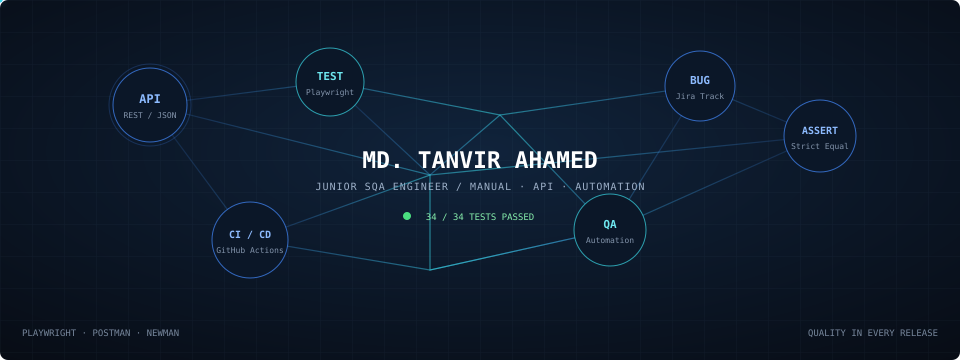

# Hi 👋, I'm Md. Tanvir Ahamed

**Junior SQA Engineer | Manual, API & Automation Testing**

I am a dedicated Junior SQA Engineer passionate about delivering reliable, bug-free, and high-performance software. Experienced in designing test cases, executing functional, regression, and performance testing, and automating workflows using Playwright and Postman

  

---

### 🌐 Connect with Me
- **Portfolio:** [tanvir-ahamed.me](https://tanvir-portfolio-topaz.vercel.app/) 
- **LinkedIn:** [linkedin.com/in/tanvir-ahamed](https://www.linkedin.com/in/md-tanvir-ahamed-330158301/?isSelfProfile=true) 
- **Email:** [ahamedtanvir93@gmail.com](mailto:ahamedtanvir93@gmail.com)
- **WhatsApp:** [+880 1792003530](https://wa.me/8801792003530)

---

### 🧰 SQA & Technical Skills

#### **Testing & Methodologies**
`Manual Testing` `Functional Testing` `Regression Testing` `Smoke & Sanity Testing` `Exploratory Testing` `Agile/Scrum` `SDLC & STLC`

#### **API & Automation**
`Postman` `Newman` `REST APIs` `Playwright` `Selenium IDE`

#### **Languages & Frameworks**
`JavaScript` `Python` `TypeScript` `C++` `Java` `PHP` `SQL`

#### **Tools & Databases**
`Jira` `VS Code` `Git & GitHub` `MySQL` `MongoDB`

---

### 🧪 Featured SQA Projects

- **[API Testing of dMoney Application](https://github.com/your-username/dmoney-api-testing)**
  - Executed REST API test suites using **Postman** & **Newman** for core financial features (deposits, transfers, cash in/out)
  - Authored automated assertions, environmental variables, and boundary test cases[cite: 2].

- **[Manual Testing of dMoney Financial App](https://github.com/your-username/dmoney-manual-testing)**
  - Conducted extensive functional, negative, and boundary testing across multi-role financial workflows

---

### 🎓 Education
- **B.Sc. in Computer Science & Engineering (Major in Software Engineering)** 
  *American International University-Bangladesh (AIUB)*